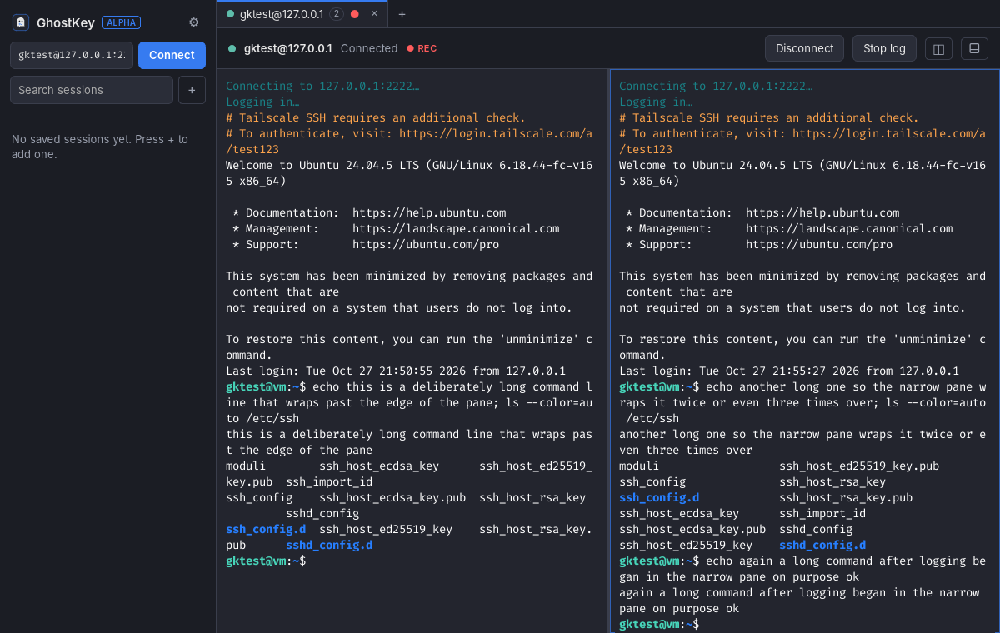
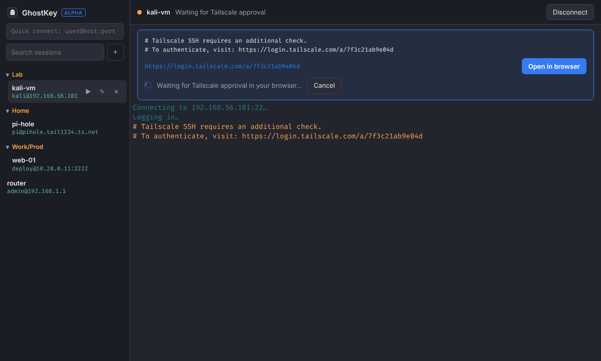
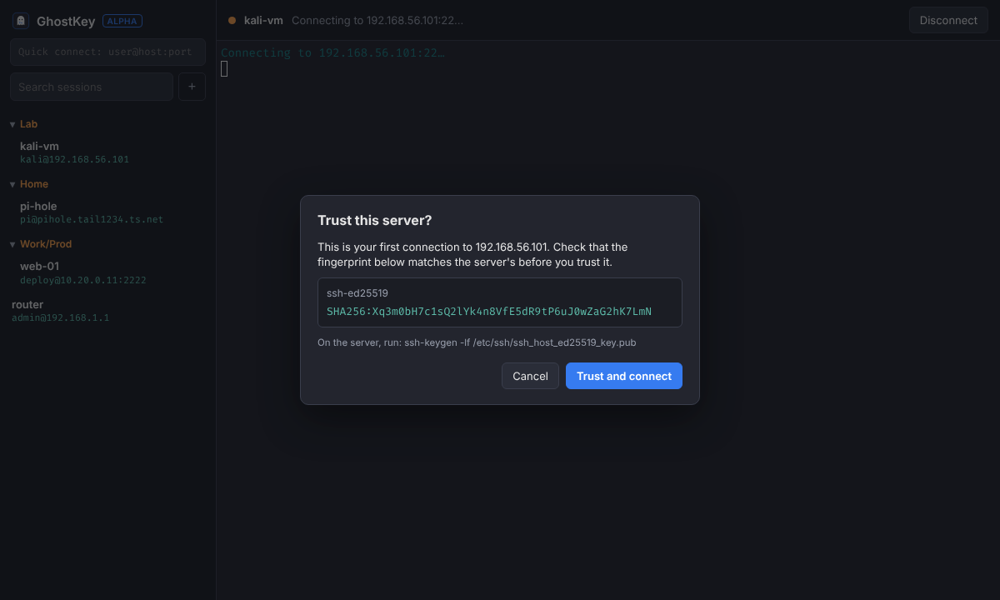
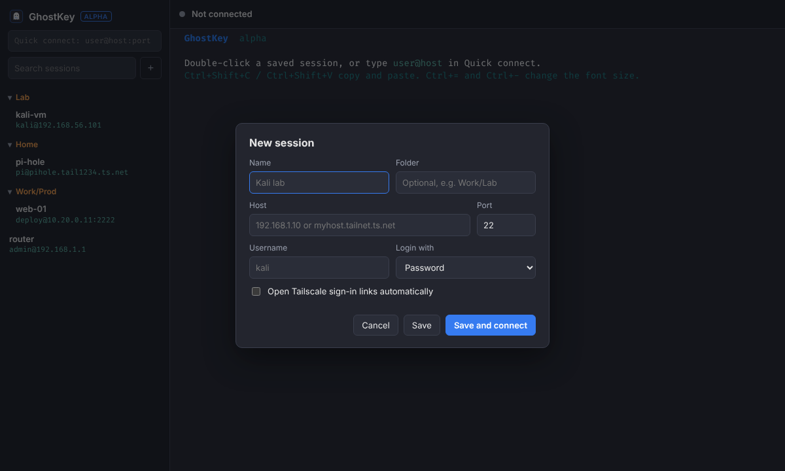
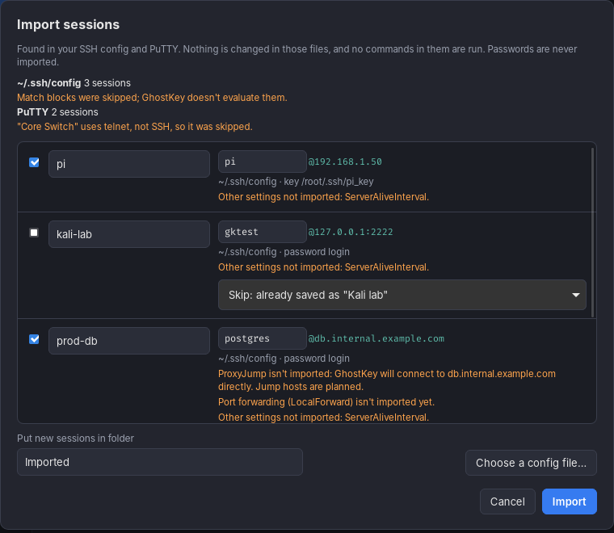
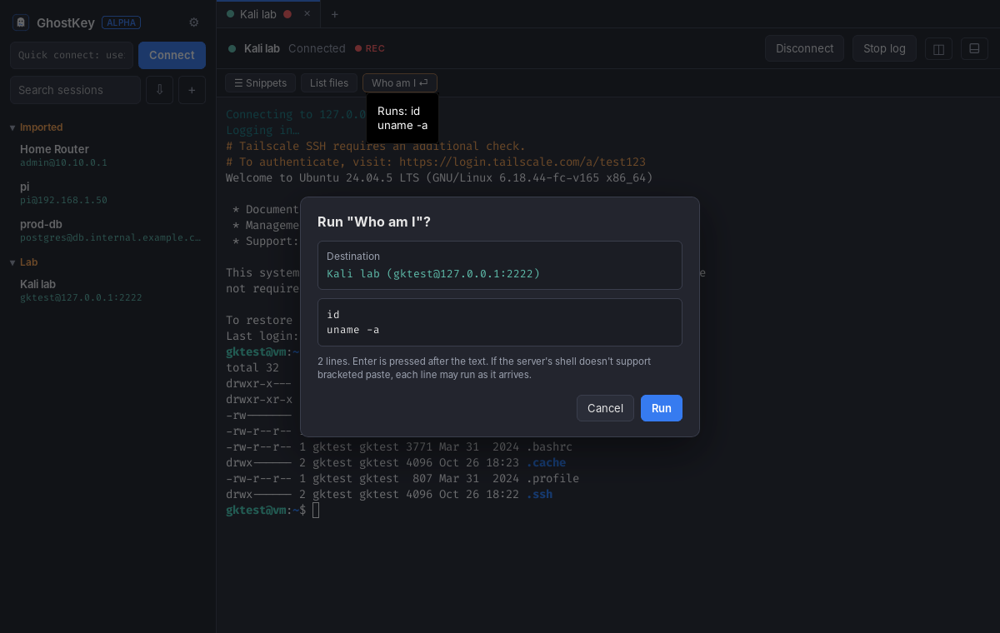
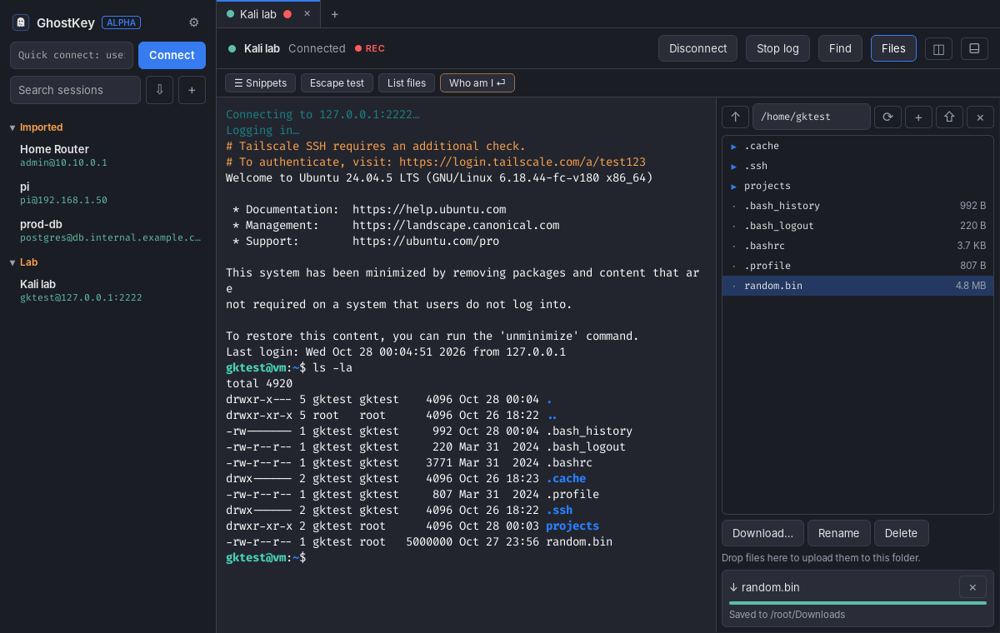
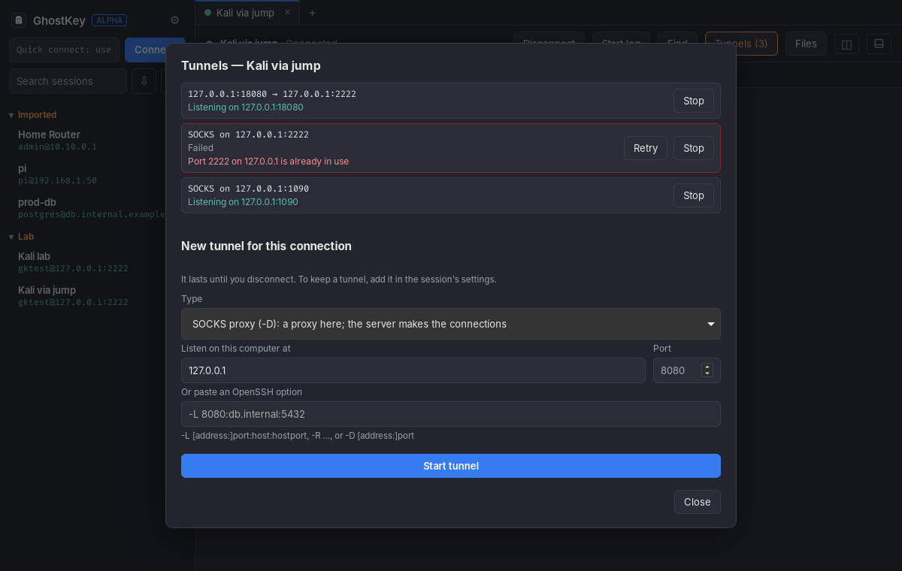

# GhostKey

A modern SSH client for Windows and Linux that looks like the Kali Linux terminal.



> **Status: alpha.** It works for everyday logins, but expect rough edges. Please report anything odd.

## What's in the alpha

- **Kali look:** Kali-Dark colors and Fira Code, taken from Kali's own QTerminal settings. Folder and file colors from `ls` and the bold `user@host` prompt look the same as on Kali.
- **Login:** password, keyboard-interactive, and private keys (OpenSSH or PuTTY `.ppk`, with or without a passphrase).
- **Host-key checks:** you confirm a new server's fingerprint once. If a known server's key changes, GhostKey blocks the connection and warns you.
- **Saved sessions:** sorted into folders, with search. Passwords are stored in your system keychain (Windows Credential Manager, or GNOME Keyring / KWallet on Linux), never in a file.
- **Tailscale SSH:** when a server in check mode sends a sign-in link, GhostKey shows it with an **Open in browser** button and waits for you to approve. You can set it to open the link automatically for each session.
- **Tabs and split panes (new in 0.2):** open as many sessions as you like in tabs, and split any tab side by side or top and bottom. Each pane has its own connection and Reconnect button. When a tab is split, each pane has a × in its corner that disconnects and closes it. Splitting a connected pane opens a second shell on the same server.
- **Import (new):** bring in sessions from `~/.ssh/config` and PuTTY with the ⇩ button. You see everything first, pick what to import, and fix names or users. Sessions you already have are skipped unless you choose to update them. GhostKey only reads those files, never runs commands from them, and tells you what it couldn't bring over (such as ProxyJump or port forwards).
- **Snippets and button bar (new):** save commands you type often, sorted into groups, and star them to get a button above the terminal. A snippet either types its text in and waits for you to press Enter (the default) or runs it. Running, or sending several lines or control characters, first shows exactly what will be sent and to which server, using the same review as pasting. Ctrl+Shift+S opens the list.
- **File browser (new):** press **Files** (Ctrl+Shift+E) to browse the server over SFTP beside the terminal, using the same login. Download files to a folder you pick, upload with the ⇧ button or by dropping files on the panel, and create folders, rename, or delete. Each transfer shows its progress and can be cancelled. A file is written under a temporary name and renamed only when it is complete, and GhostKey asks before replacing an existing file. Folders can't be transferred yet. If a server has no SFTP, the panel says so and the terminal is unaffected.
- **Tunnels and jump hosts (new):** save port forwards with a session: local (`-L`), remote (`-R`), and SOCKS proxies (`-D`). You can type them the OpenSSH way, such as `-L 8080:db:5432`. They start when the session connects, listen on 127.0.0.1 unless you explicitly allow other computers, and stop when it disconnects. **Tunnels** in the toolbar shows each tunnel's address, open connections and errors (such as a port already in use), and lets you stop, retry, or add a temporary one. A session can also connect through another saved session as a jump host, like `ssh -J`. Each server's host key is checked and each asks for its own login.
- **Session logging (new in 0.2):** save what a session prints to a timestamped text file, with colors removed. Start and stop it from the toolbar, or set a saved session to log automatically. Choose the folder in Settings (⚙).

| Tailscale sign-in | New host key | Session editor |
| --- | --- | --- |
|  |  |  |

| Import preview | Snippet preview | File browser |
| --- | --- | --- |
|  |  |  |

| Tunnels |
| --- |
|  |

## Install the alpha

Every push builds installers in GitHub Actions. Open the latest **CI** run on the [Actions tab](../../actions), scroll down to **Artifacts**, and download:

- **GhostKey-Windows:** a `.msi` or `-setup.exe` installer.
- **GhostKey-Linux:** a `.deb` (Debian, Ubuntu, Kali), a `.rpm` (Fedora), or an `.AppImage` (any distribution).

The Windows installers aren't code-signed yet, so SmartScreen will warn you. Click **More info**, then **Run anyway**.

Tagged releases (`v0.2.0` and so on) are published as draft pre-releases on the [Releases page](../../releases).

## Keyboard shortcuts

| Keys | Action |
| --- | --- |
| Ctrl+Shift+T | New tab |
| Ctrl+Shift+W | Close the focused pane |
| Ctrl+Shift+R / Ctrl+Shift+D | Split right / split down |
| Alt+Arrow keys | Move between panes |
| Alt+1 … Alt+9, Ctrl+PgUp / Ctrl+PgDn | Switch tabs |
| Ctrl+Shift+L | Start or stop logging |
| Ctrl+Shift+S | Snippets |
| Ctrl+Shift+E | Show or hide the file browser |
| Ctrl+Shift+F | Find in the terminal |
| Ctrl+Shift+C / Ctrl+Shift+V | Copy / paste |
| Right-click | Copy the selection, or paste when nothing is selected |
| Ctrl+= / Ctrl+- / Ctrl+0 | Bigger / smaller / default font size |
| Ctrl+click a link | Open it in your browser |

## Where your data lives

| What | Where |
| --- | --- |
| Saved sessions | `sessions.json` in the app config folder (`%APPDATA%\com.anon0ne.ghostkey` on Windows, `~/.config/com.anon0ne.ghostkey` on Linux) |
| Trusted host keys | `known_hosts` in the same folder (OpenSSH format) |
| Passwords and passphrases | Your system keychain, under the service name "GhostKey" |
| Settings | `settings.json` in the app config folder |
| Snippets | `snippets.json` in the app config folder |
| Session logs | `Documents/GhostKey Logs` unless you pick another folder in Settings. Logs hold everything the server printed, which can include secrets |

## Building from source

You need Rust (stable), Node.js 20 or later, and the [Tauri prerequisites](https://v2.tauri.app/start/prerequisites/) for your OS. On Debian or Kali:

```sh
sudo apt install libwebkit2gtk-4.1-dev libgtk-3-dev libayatana-appindicator3-dev librsvg2-dev libdbus-1-dev
```

Then:

```sh
npm install
npm run tauri dev      # run with hot reload
npm run tauri build    # build installers into src-tauri/target/release/bundle
```

### Tests

```sh
npm test                   # frontend: connection lifecycle and split layout
cd src-tauri && cargo test # Rust core
```

The live SSH tests run against a real OpenSSH server. To run them locally, start the throwaway server with `sudo scripts/test-sshd.sh /tmp/gk-sshd`, export the variables it prints, then run `cargo test`.

## Design

See [SPEC.md](SPEC.md) for the full v1 design: scope, theme values, architecture, and how login works.
